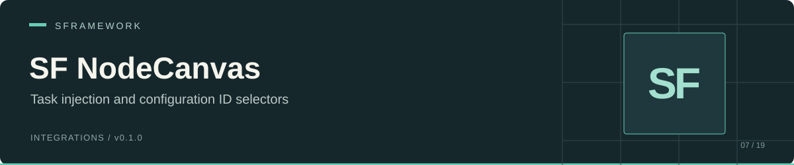

# SF NodeCanvas

[Documentation website](https://docs.secretplace.studio/#sf-nodecanvas)

SFramework dependency injection for NodeCanvas action and condition tasks, plus a configuration ID selector for the NodeCanvas task inspector. Derive your custom task from an SF base class to inject its dependencies when NodeCanvas initializes it.

Package: `sp.sframework.nodecanvas` · Version: `0.1.0` · [MIT license](LICENSE.md)

[Install](#install) · [Task initialization](#task-initialization) · [Example action](#example-action) · [Configuration IDs](#configuration-ids) · [API](#api) · [Limits](#limits-and-troubleshooting)

## Install

In Unity's Package Manager, choose **Add package from git URL** and enter:

```text
https://github.com/huran438/sf-nodecanvas.git#main
```

Install the requirements in the same Unity project:

| Requirement | Assembly references |
| --- | --- |
| NodeCanvas | `NodeCanvas`, `ParadoxNotion` |
| [SF Core](https://github.com/huran438/sf-core) | `SFramework.Core.Runtime`; editor assembly also references `SFramework.Core.Editor` |
| [SF Configs](https://github.com/huran438/sf-configs) | `SFramework.Configs.Runtime`; editor assembly also references `SFramework.Configs.Editor` |

NodeCanvas is an external dependency. This repository does not bundle or install it. The manifest has an empty `dependencies` object; install the dependencies of SF Core and SF Configs as well, including UniTask and Newtonsoft.Json.

Both package assemblies require the `NODECANVAS` scripting define symbol. Confirm that the symbol exists for the project's compilation target. Adding the symbol without the required assemblies will cause unresolved references.

Your task assembly should reference `SFramework.NodeCanvas.Runtime` and `SFramework.Core.Runtime`; add `SFramework.Configs.Runtime` if the task uses configurations. Use the same `NODECANVAS` constraint for assemblies containing these tasks.

The manifest declares Unity `2019.4`. That declaration does not establish compatibility with the current source and dependency versions. This README reflects static source inspection; no Unity or NodeCanvas execution accompanies it.

## Task initialization

The four task base classes follow the same sequence:

```text
NodeCanvas OnInit()
  -> this.Inject() through SF Core
  -> injected fields and properties
  -> methods marked [SFInject], including the Init() hook
  -> NodeCanvas base.OnInit()
```

Register dependencies in the SF Core container before a graph initializes its tasks. If a task reads service data during its `Init()` hook, initialize those services before starting the graph too. With `SFContextRoot`, wait for `WaitForInitialization()` in your graph bootstrap.

Use `Init()` for setup after injection. If you override `OnInit()`, call `base.OnInit()` to retain the package's injection step. The generic bases accept `T : class` and pass their agent type through to NodeCanvas.

## Example action

This action logs the number of configurations available from an injected `ISFConfigsService`, then completes. Save it in your runtime task assembly:

```csharp
#if NODECANVAS
using System.Linq;
using SFramework.Configs.Runtime;
using SFramework.Core.Runtime;
using SFramework.NodeCanvas.Runtime;
using UnityEngine;

public sealed class LogLoadedConfigs : SFActionTask
{
    [SFInject]
    private ISFConfigsService _configs;

    private int _count;

    [SFInject]
    protected override void Init()
    {
        _count = _configs == null ? -1 : _configs.Configs.Count();
    }

    protected override void OnExecute()
    {
        if (_count < 0)
        {
            Debug.LogError("ISFConfigsService was not registered.");
            EndAction(false);
            return;
        }

        Debug.Log($"Loaded configurations: {_count}");
        EndAction(true);
    }
}
#endif
```

Register `ISFConfigsService` to `SFConfigsService` in your context's `Bind()` method, let the context finish initializing, and assign `LogLoadedConfigs` to an action node. The example uses NodeCanvas' `OnExecute()` and `EndAction(bool)` lifecycle described in its [custom task documentation](https://nodecanvas.paradoxnotion.com/documentation/?section=creating-custom-tasks).

For a condition, derive from `SFConditionTask` or `SFConditionTask<T>` and implement NodeCanvas' `OnCheck()` method. SF injection still takes place in `OnInit()`.

## Configuration IDs

Use `[SFIdNodeCanvas]` on a **string field** inside a task. Pass the root configuration type whose cached IDs should appear in the dropdown:

```csharp
#if NODECANVAS
using System;
using Newtonsoft.Json;
using SFramework.Configs.Runtime;
using SFramework.NodeCanvas.Runtime;
using UnityEngine;

[Serializable]
public sealed class EnemyCatalog : SFNodesConfig
{
    [JsonIgnore]
    public override ISFConfigNode[] Children => null;
}

public sealed class LogEnemySelection : SFActionTask
{
    [SFIdNodeCanvas(typeof(EnemyCatalog), indent: 0)]
    public string EnemyId = string.Empty;

    protected override void OnExecute()
    {
        Debug.Log(EnemyId);
        EndAction(true);
    }
}
#endif
```

For this root-only example, create a config JSON with `Type` first:

```json
{
  "Type": "EnemyCatalog",
  "Version": 0,
  "Id": "enemies"
}
```

Put the file in a folder listed by `SFConfigsSettings.ConfigsPaths`, then use **Tools > SFramework > Refresh Configs**. The selector reads the shared editor cache. Place the file under Resources as well if `SFConfigsService` must load it at runtime. See [SF Configs setup](https://github.com/huran438/sf-configs#editor-workflow) for the settings file and node-tree model.

The optional `indent` selects path depth: `0` for roots, `1` for direct children, and `-1` for the deepest cached level. The empty dropdown choice stores an empty string. A nonempty value missing from the cache stays available as a text field. The attribute stores an ID; your task must resolve that ID to application data.

## API

| API | Role |
| --- | --- |
| `SFActionTask` | Injected base for an untyped NodeCanvas action |
| `SFActionTask<T> where T : class` | Injected base for an action with a typed agent |
| `SFConditionTask` | Injected base for an untyped NodeCanvas condition |
| `SFConditionTask<T> where T : class` | Injected base for a condition with a typed agent |
| `protected virtual void Init()` | `[SFInject]` setup hook on each base class |
| `SFIdNodeCanvasAttribute(Type, int indent = -1)` | ParadoxNotion drawer attribute with readonly `Type` and `Indent` fields |
| `SFIdNodeCanvasAttributeDrawer` | NodeCanvas editor drawer that reads SF Configs' cached node paths |

Runtime namespace: `SFramework.NodeCanvas.Runtime`. Editor namespace: `SFramework.NodeCanvas.Editor`.

## Limits and troubleshooting

- Missing SF task types usually indicate an absent `NODECANVAS` define or unresolved assembly references. The define is a compilation gate; it does not install NodeCanvas.
- A null injected dependency means the container did not contain the required registration when the task initialized. Injection does not wait for service initialization.
- The package injects during NodeCanvas initialization, rather than on every action execution or condition check. Lifecycle scheduling and graph behavior remain NodeCanvas' responsibility.
- If no cached paths exist, the ID drawer falls back to the next NodeCanvas drawer. Refresh SF Configs, check `ConfigsPaths`, and use the root configuration type. The drawer does not build the configuration cache itself.
- ID paths inherit SF Configs' depth and hash-set ordering behavior. The default deepest level may omit shorter branches, and no runtime ID resolver accompanies the attribute.
- This package provides base classes and one inspector integration. It supplies no ready-made game actions, graph assets, or service registrations.

## Source and related packages

- [Action bases](Runtime/SFActionTask.cs) and [condition bases](Runtime/SFConditionTask.cs)
- [ID attribute](Runtime/SFIdNodeCanvasAttribute.cs) and [NodeCanvas drawer](Editor/SFIdNodeCanvasAttributeDrawer.cs)
- [Runtime assembly](Runtime/SFramework.NodeCanvas.Runtime.asmdef) and [editor assembly](Editor/SFramework.NodeCanvas.Editor.asmdef)
- [SF Core](https://github.com/huran438/sf-core) and [SF Configs](https://github.com/huran438/sf-configs)

Source snapshot: [`8fe972aaacc7f564770a9567f6b2f430d05985b1`](https://github.com/huran438/sf-nodecanvas/commit/8fe972aaacc7f564770a9567f6b2f430d05985b1) (`main`). Example validation: static API review only; no compilation or execution in Unity.
